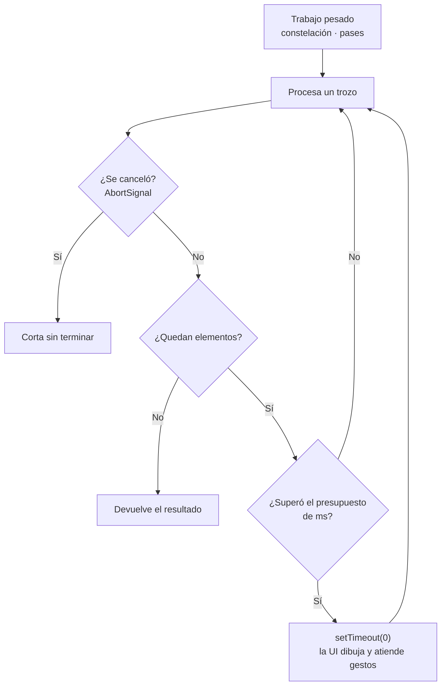
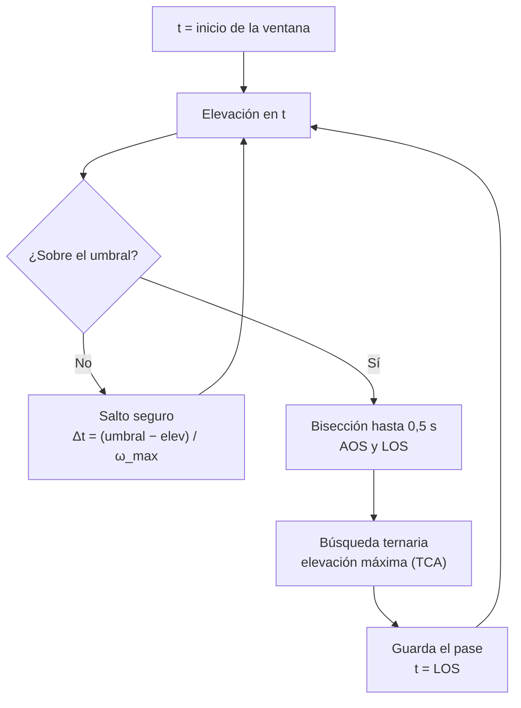
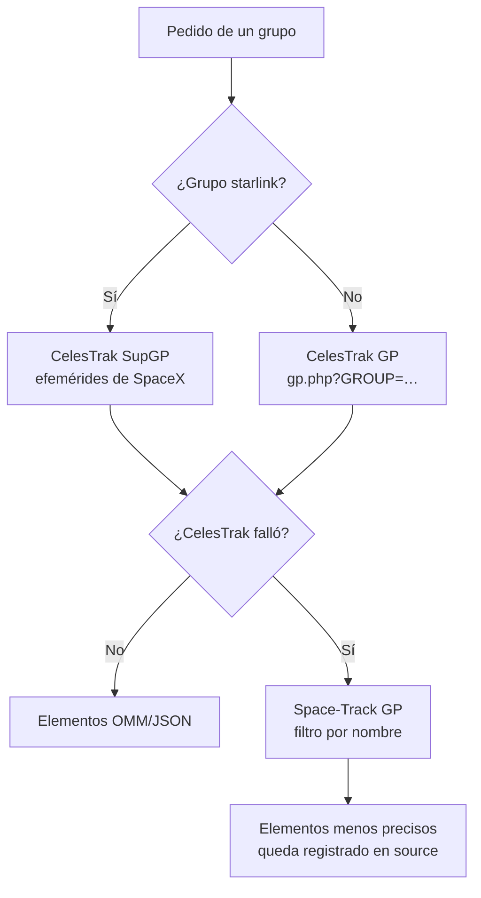
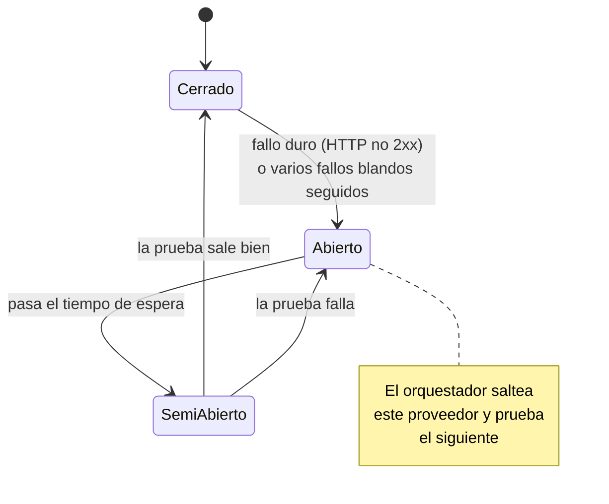
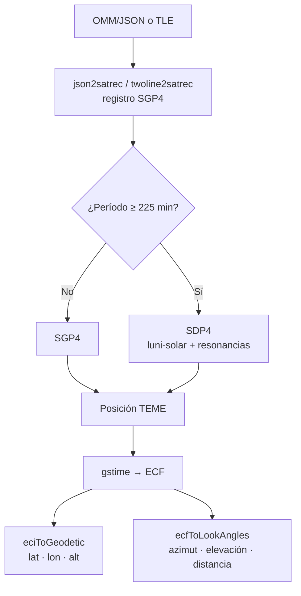
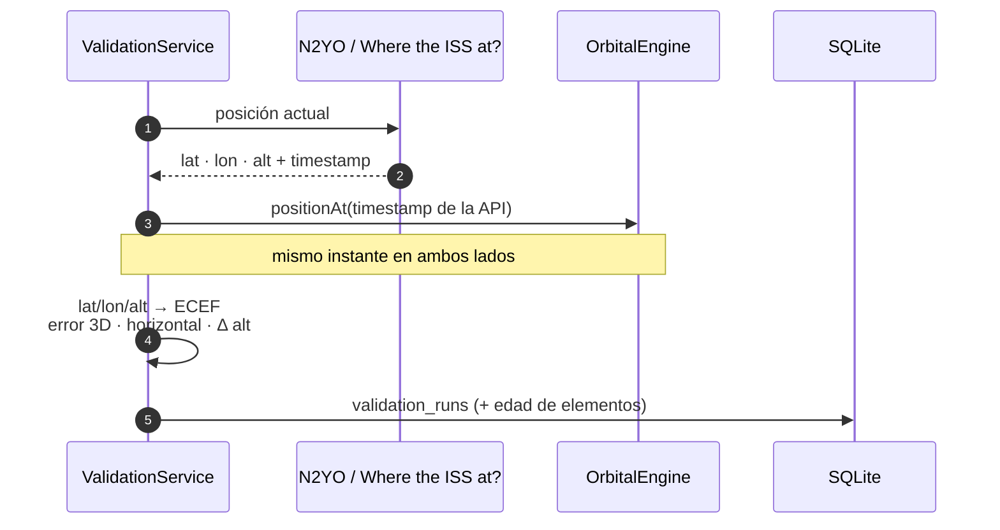

# 📘 Informe técnico — Satellite Tracker (TP7)

Justificación técnica de la app: cómo se propaga, de dónde salen los datos, qué supuestos tiene SGP4 y cómo se valida.
Programación Móviles 2026 · Licenciatura en Sistemas de Información · FCyT – UADER.

| Sección | Qué responde |
|---------|--------------|
| §0 | Cómo está resuelto el cálculo (hilo JS, pases, antimeridiano, footprint) |
| §1 | Por qué Starlink usa el set suplementario SupGP |
| §2 | Límites de las APIs y estrategia de caché / fallback |
| §3 | Supuestos y limitaciones del modelo SGP4 |
| §4 | Validación cruzada: método y resultados esperados |

> ⚠️ Los resultados de §4.3 son **valores esperados**. Los números reales salen de ejecutar la app en un
> teléfono y se completan en la plantilla §4.4 antes de la entrega.

---

## 🧮 0. Resumen de la solución

| Tema | Decisión |
|------|----------|
| Propagación | SGP4/SDP4 local con `satellite.js` 6.x, a partir de elementos OMM/JSON (también acepta TLE) |
| Datos | CelesTrak (principal) → Space-Track (respaldo); caché SQLite con TTL de 12–24 h |
| Starlink | Set suplementario SupGP de CelesTrak (`sup-gp.php?FILE=starlink`) |
| Concurrencia | Hermes no tiene Web Workers → _chunking_ cooperativo con presupuesto de tiempo |
| Pases | Barrido adaptativo grueso→fino, bisección para AOS/LOS, búsqueda ternaria para el máximo |
| Antimeridiano | Corte de polilíneas cuando \|Δlon\| > 180° con interpolación de la latitud en ±180° |
| Validación | Posición local calculada **en el instante que informa la API**; error = distancia 3D en ECEF |

### 0.1 Estrategia para no bloquear el hilo JS

Hermes (el motor JS de React Native) no soporta Web Workers y mover el cálculo a JSI/TurboModule exigiría
código nativo propio. Con un costo medido de unas decenas de microsegundos por propagación (§0.2) alcanza con
**no ocupar el hilo más de unos pocos milisegundos seguidos**:



1. `TimeSlicer` (`src/core/orbital/chunkScheduler.ts`) mide el tiempo con `performance.now()`; cuando el
   trozo supera su presupuesto (por defecto unos ms) cede el control con `setTimeout(0)`, de modo que la UI
   puede dibujar y atender gestos entre trozos. Acepta `AbortSignal`: si el usuario cambia de satélite o sale
   de la pantalla, el cálculo en curso se cancela.
2. **Constelación** (`constellation.ts`): los elementos se convierten una sola vez a registros SGP4
   (`load`), y cada actualización (`snapshot`) escribe lat/lon en un `Float32Array` reutilizable, procesando
   por trozos. Luego `selectVisible` recorta por viewport y por tope (150 por defecto) antes de renderizar.
3. **Render:** la constelación va en una sola fuente GeoJSON con una capa `circle` de MapLibre: se dibuja en
   GPU, sin una vista nativa por satélite que haya que re-medir en cada frame.
4. **Pases:** en lugar de evaluar cada pocos segundos durante días, el barrido es adaptativo (§0.3).
5. **Persistencia:** las inserciones en SQLite se hacen en lotes multi-fila (100 elementos o 250 miembros por
   sentencia) dentro de una transacción.

### 0.2 Costos medidos

Medidos en Node 22 (Jest) dentro del entorno de desarrollo, con elementos de la ISS. **No son tiempos de
Hermes en un teléfono**; un teléfono será varias veces más lento, por eso el diseño cede el hilo igualmente.

| Operación | Tiempo medido |
|-----------|---------------|
| `positionAt` (SGP4 + ECI→geodésico), 20 000 llamadas | **22 µs** por llamada |
| Constelación: 1 500 satélites, carga de registros | 37 ms |
| Constelación: 1 500 satélites, un `snapshot` completo | 37 ms |
| Pases de 48 h (elevación mín. 10°), 8 pases encontrados | 113 ms, **7 106 muestras** |
| Mismo cálculo con paso fijo de 5 s | 34 560 muestras (≈ 4,9× más) |
| Ground track completo (período previo y posterior) | 6 ms |
| Footprint (con cierre en polo / recorte en antimeridiano), 1 000 cálculos | 131 µs por cálculo |

En el barrido de pases, 7 106 muestras incluyen las de la bisección y de la búsqueda del máximo; el paso fijo
de 5 s comparado ni siquiera refina AOS/LOS, de modo que su error sería de hasta unos segundos.

### 0.3 Predicción de pases (RF-04)

Algoritmo (`src/core/orbital/passPredictor.ts`):

1. **Barrido grueso con paso adaptativo.** Se acota cuánto puede subir la elevación por segundo: la velocidad
   angular máxima de un satélite visto desde la superficie ocurre en el perigeo,
   `ω_max ≈ (v_perigeo / h_perigeo) × 1,2` (margen del 20 %). Si la elevación está lejos del umbral, se puede
   saltar `Δt = (e_umbral − e_actual) / ω_max` sin riesgo de saltearse un pase. Para la ISS `ω_max ≈ 1,29 °/s`.
2. **Bisección** (hasta 0,5 s) sobre el cruce de la elevación mínima para obtener **AOS** y **LOS**.
3. **Búsqueda ternaria** del máximo de elevación entre AOS y LOS (instante de máxima aproximación, TCA).
4. **Pase en curso:** si al inicio de la ventana el satélite ya está sobre el umbral, se busca hacia atrás el
   AOS real y el pase se marca `inProgress`; si el LOS excede el horizonte de búsqueda se marca `truncated`.
5. AOS, LOS y TCA se redondean al segundo para que `duración = LOS − AOS` sea consistente.



Verificación: contra una búsqueda de fuerza bruta de 1 s, el AOS/LOS coincide dentro de ±2 s y la elevación
máxima dentro de ±0,05° (test `passPredictor.test.ts`). Se probó además con órbitas GEO (SDP4) y GPS/MEO, donde
los pases duran horas o no terminan en el horizonte.

### 0.4 Ground track y antimeridiano (RF-11)

Sea `λ_i` la longitud del punto i, normalizada a [−180, 180). Si entre dos puntos consecutivos

```
|λ_{i+1} − λ_i| > 180°
```

entonces el segmento cruza el antimeridiano (el camino corto da la vuelta por ±180°). En ese caso:

1. Se determina el sentido: si `λ_i > 0` y `λ_{i+1} < 0` el satélite va hacia el este (cruza por +180°);
   en el caso inverso, hacia el oeste (cruza por −180°).
2. Se desenrolla la longitud siguiente: `λ'_{i+1} = λ_{i+1} ± 360°` para que el salto sea menor a 180°.
3. Se interpola la latitud en el cruce: `t = (L − λ_i) / (λ'_{i+1} − λ_i)`, con `L = ±180°`, y
   `φ_c = φ_i + t · (φ_{i+1} − φ_i)`.
4. Se cierra el tramo actual en `(φ_c, ±180°)` y se abre el siguiente en `(φ_c, ∓180°)`.

El resultado es una lista de **polilíneas separadas** (un `MultiLineString` GeoJSON), que MapLibre dibuja sin
la línea horizontal falsa de lado a lado. El paso de muestreo del ground track va de 30 a 240 s según el período orbital
(`groundTrackStepSec`).

### 0.5 Footprint (RF-12)

Con elevación mínima `ε` y altitud `h` del satélite, el radio angular central de cobertura es

```
λ = arccos( R_e · cos ε / (R_e + h) ) − ε
```

(`R_e` = 6 371 km). Para la ISS a ~420 km y ε = 10° resulta λ ≈ 12,5° ≈ 1 390 km de radio. El polígono se
genera con puntos a distancia angular `λ` del punto subsatelital (fórmula del destino sobre la esfera). Casos
tratados: el polígono **cruza el antimeridiano** (se desenrolla y se recorta contra [−180, 180] generando
copias a ±360° con Sutherland–Hodgman) y el polígono **contiene un polo** (se cierra pasando por el polo).

---

## 🛰️ 1. Uso del set suplementario (SupGP) para Starlink

### 1.1 El problema

Los elementos GP/TLE públicos del catálogo general se obtienen ajustando observaciones de radar y ópticas
con un modelo de perturbaciones general (el mismo para todos los objetos). Para la mayoría de los satélites
eso funciona bien, pero **los Starlink maniobran con frecuencia** (propulsión eléctrica, elevación de órbita,
mantenimiento de altitud y evasión de colisiones). Cuando un satélite maniobra entre observaciones, un ajuste
generado a partir de datos de antes o después de la maniobra puede no representar la trayectoria real durante
el intervalo; y con órbitas bajas, el arrastre atmosférico variable agrava la deriva.

### 1.2 La solución: datos suplementarios

CelesTrak publica **Supplemental GP Data (SupGP)**: conjuntos de elementos generados a partir de
**efemérides que entrega el propio operador** (en este caso, SpaceX), que conoce sus maniobras planificadas y
su actitud. Según la documentación de CelesTrak, se publican en los mismos formatos que el GP común
(OMM en JSON/XML/CSV y TLE), de modo que se propagan con el mismo SGP4. La app los pide con:

```
https://celestrak.org/NORAD/elements/supplemental/sup-gp.php?FILE=starlink&FORMAT=json
```

Para el resto de los grupos (estaciones, GPS, clima, GEO) se usa el endpoint GP común (`gp.php?GROUP=…`).

### 1.3 Consecuencias de diseño



- **Es una decisión por grupo**, no global: en `CelesTrakProvider` el grupo `starlink` apunta a SupGP y el
  resto a GP.
- **Fallback:** Space-Track no ofrece SupGP; si CelesTrak falla, Starlink se obtiene del GP de Space-Track
  filtrando por nombre. Es una **degradación consciente de precisión**; la app lo registra en el origen del
  dato (`source`) y la advertencia de antigüedad (RF-16) sigue aplicando.
- **Formato OMM/JSON en lugar de TLE:** el TLE no puede representar números de catálogo NORAD de más de 5
  dígitos (y el catálogo está superando ese límite en 2026). OMM/JSON no tiene esa restricción y
  `satellite.js` lo lee con `json2satrec`. Por eso el flujo interno usa OMM; TLE se acepta como alternativa.
- **Vigencia más corta:** los SupGP se ajustan a un intervalo de efemérides; fuera de él se degradan igual que
  cualquier TLE. La antigüedad se mide desde la **época** de los elementos, no desde la descarga.
- **Tamaño:** Starlink supera los 9 000 objetos. La app limita a 1 500 por grupo al almacenar y a
  150–300 al dibujar (ajustable), y permite buscar por nombre o NORAD ID sobre todo el catálogo.

---

## 🌐 2. Límites de las APIs y estrategia de caché/fallback

### 2.1 Límites y política aplicada

| Fuente | Rol | Límite del proveedor | Límite que aplica la app | Autenticación |
|--------|-----|----------------------|--------------------------|---------------|
| CelesTrak | Principal | Pide no consultar el mismo grupo más de una vez cada 2 h; puede bloquear IPs que insistan tras un error | 1 req / 2 s y 30 / h; **se detiene ante cualquier respuesta no 200** (el breaker abre de inmediato) | Ninguna |
| Space-Track | Respaldo | < 30 req/min y 300/h | **20 / min y 250 / h**; sesión por cookie, relogueo cada 50 min | Usuario + contraseña (login en `/ajaxauth/login`) |
| N2YO | Validación | 1 000 transacciones/h (posiciones y TLE) | **2 / s y 900 / h** | API key en la URL (`&apiKey=`) |
| Where the ISS at? | Validación (solo ISS) | ≈ 1 req/s | 1 req cada 1,2 s | Ninguna |

Particularidades que el código contempla:

- Space-Track devuelve **HTTP 200 con `{"Login":"Failed"}`** ante credenciales inválidas: se trata como error
  de autenticación y no como respuesta válida.
- La API key de N2YO viaja en la URL, por lo que los errores de la capa HTTP solo informan proveedor y código
  (`N2YO: HTTP 401`), nunca la URL.
- Las credenciales se guardan solo en `expo-secure-store` (Keychain/Keystore) con el nivel
  `AFTER_FIRST_UNLOCK`; no se escriben en SQLite ni en AsyncStorage.

### 2.2 Estrategia de caché

- **Almacenamiento:** SQLite (`expo-sqlite`) con tablas `elements`, `group_meta`, `group_members` y
  `validation_runs`. Los ajustes viven en el _kv-store_ de `expo-sqlite`.
- **TTL:** configurable entre **12 y 24 h** (el valor se acota siempre al rango). Los elementos orbitales
  cambian lentamente, y hasta 24 h no degradan la posición de forma apreciable frente al error propio de SGP4.
- **Lectura:** (1) caché vigente → se devuelve sin tocar la red; (2) caché vencida o ausente → se consulta el
  primer proveedor disponible; (3) si todos fallan y hay datos vencidos, se sirven **marcados como `stale`**
  (_stale-while-error_) en lugar de dejar la app sin datos.
- **Actualización forzada:** el botón de refrescar se ignora si la última descarga fue hace menos de 2 h
  (respeta el límite de CelesTrak).
- **Antigüedad (RF-16):** `assessFreshness` clasifica en `fresh` (< 3 días de época y TTL vigente), `aging`
  (> 3 días o TTL vencido) y `stale` (> 7 días de época). La UI muestra un aviso con la antigüedad de la
  época y de la descarga. Se justifica porque la precisión de un TLE en LEO se degrada del orden de 1–3 km
  por día.

### 2.3 Resiliencia y fallback automático

Cada proveedor está envuelto en `ResilientHttp`:

- **RateLimiter** de ventana deslizante (varias ventanas simultáneas: por segundo/minuto y por hora).
- **CircuitBreaker** (cerrado / abierto / semiabierto). Distingue fallos **duros** (cualquier respuesta HTTP
  no exitosa: en CelesTrak el breaker abre de inmediato y espera, por su política de bloqueo de IPs) de
  **blandos** (error de red o _timeout_ de 20 s: el breaker abre tras varios consecutivos). En semiabierto
  deja pasar una sola prueba.
- **retryWithBackoff**: espera exponencial acotada (tope de 4 s) que respeta el encabezado `Retry-After`;
  máximo 2 intentos y solo para errores de red, 429 y 5xx.
- **Reloj inyectable** (`Clock`), lo que permite probar toda la lógica de tiempo sin esperas reales.

Ciclo de vida del circuit breaker de cada proveedor:



El flujo completo de decisión del orquestador (caché → CelesTrak → Space-Track → caché vencida) está en el
README, sección 🚨 Manejo de errores.

El `DataOrchestrator` recorre los proveedores en orden de prioridad. Un proveedor sin credenciales, con el
breaker abierto o sin la capacidad pedida se salta; si todos fallan, se informa la lista completa de intentos
(`ProviderAttempt`) y se cae a la caché vencida si existe. Patrón: **Strategy** (cada proveedor implementa la
misma interfaz `DataProvider` con `capabilities`), construidos por una factoría (`createDataProviders`).
N2YO y Where the ISS at? solo declaran la capacidad `validation`; nunca alimentan al motor.

### 2.4 Segundo plano y notificaciones

- Los avisos son **notificaciones locales programadas** (`expo-notifications`, disparador por fecha), una por
  pase, `N` minutos antes del AOS. Se agendan por adelantado con **72 h** de pases. iOS admite 64
  notificaciones locales pendientes, por lo que la app limita a 60 en total.
- La tarea en segundo plano (`expo-background-task`, intervalo mínimo de 180 min) **solo refresca efemérides
  vencidas y reagenda**; no es necesario que corra puntualmente para que los avisos ya agendados se disparen.
  El sistema decide cuándo ejecutarla (iOS suele diferirla horas), así que el diseño no depende de ella.
- **Se deshabilitó el permiso de ubicación en segundo plano.** Los avisos usan la última ubicación conocida
  guardada. Evita un permiso sensible y una revisión más estricta de las tiendas por una función que no lo
  necesita.

---

## 📐 3. Modelo de propagación: supuestos y limitaciones

### 3.1 Modelo usado



- **SGP4** para órbitas con período < 225 min y **SDP4** (con perturbaciones luni-solares y resonancias) para
  período ≥ 225 min; `satellite.js` elige el modo automáticamente (GEO verificado: método `'d'`, ~35 786 km
  de altitud, período ≈ 1 436 min).
- **Entrada:** elementos OMM/JSON (o TLE). Salida: posición/velocidad en el marco **TEME**.
- **Cadena de conversión:** TEME → ECF con el tiempo sidéreo de Greenwich (`gstime`) → geodésico WGS84
  (`eciToGeodetic`). Para az/el: `ecfToLookAngles` con el observador en geodésico y la distancia (_range_).
- **Test de referencia:** el vector oficial 00005 de Vallado (SGP4-VER) se reproduce dentro de la tolerancia
  del test. OMM y TLE del mismo objeto dan la misma posición.

### 3.2 Supuestos

1. Los elementos son **elementos medios (_mean elements_)** generados para SGP4; no sirven para otro
   propagador.
2. El tiempo se trata como **UTC ≈ UT1** para la rotación terrestre (`gstime` de `satellite.js` no aplica
   UT1−UTC). Como |UT1−UTC| < 0,9 s y la superficie se mueve hasta ~0,46 km/s en el ecuador, el error
   sistemático es **hasta ~0,4 km** en longitud.
3. **Movimiento polar ignorado** (decenas de metros).
4. El observador se modela como un punto (lat, lon, altitud sobre el elipsoide) fijo en la corteza.
5. El GPS del teléfono aporta altitud sobre el elipsoide o sobre el geoide según la plataforma; la diferencia
   (decenas de metros) es despreciable para az/el de un satélite a cientos de km.
6. La visibilidad de un pase es **geométrica**: el satélite está sobre el umbral de elevación configurado
   (10° por defecto, `minElevationDeg`).

### 3.3 Limitaciones

| Limitación | Efecto |
|------------|--------|
| **Precisión intrínseca de SGP4** | ~1 km en la época del TLE; **crece ~1–3 km/día** en LEO, sobre todo en la dirección de avance (error de fase). Más rápido con baja altitud y alta actividad solar |
| **Maniobras** | SGP4 no las conoce; un pase calculado después de una maniobra no anunciada puede errar por kilómetros o minutos. Por eso se usa SupGP en Starlink y se avisa de la antigüedad |
| **Sin corrección atmosférica fina** | No se modela la refracción atmosférica: cerca del horizonte la elevación aparente es hasta ~0,5° mayor que la geométrica, por lo que AOS/LOS reales ocurren unos segundos antes/después. Tampoco se modela el arrastre más allá del término B* del propio elemento |
| **Sin condiciones de iluminación** | No se calcula si el satélite está iluminado y el observador a oscuras (el criterio de "pase visible" a ojo desnudo). Un pase de la lista puede ser de día o durante el eclipse del satélite |
| **Footprint esférico** | Se calcula con `R_e = 6 371 km` y sin relieve; el error contra un elipsoide es de unas decenas de km en el borde como máximo, no relevante a escala de mapa |
| **Sin perturbaciones propias** | No se incorporan maniobras, presión de radiación detallada ni modelos de arrastre propios |
| **Hardware** | La brújula depende de la calidad y calibración del magnetómetro (y de interferencias); la declinación magnética se obtiene de `expo-location` (`trueHeading − magHeading`) |
| **Reloj** | Se asume el reloj del teléfono sincronizado por red; un desfase de 1 s equivale a ~7,7 km en LEO |
| **Sin backend propio** | Cada dispositivo consulta las APIs directamente; con muchos usuarios compartiendo IP (p. ej. una red de campus) podría verse afectado el límite de CelesTrak |

### 3.4 Brújula (RF-07)

Orientación con compensación de inclinación a partir de acelerómetro + magnetómetro: con `a` la gravedad y
`m` el campo magnético, Este = `m × a`, Norte = `a × Este`, y la dirección que apunta el teléfono es `−z`
(la parte trasera). El acelerómetro de iOS tiene el signo opuesto al de Android, y se normaliza. La guía
al satélite compara el azimut/elevación apuntado con el calculado y devuelve el desvío angular.

### 3.5 Por qué no hay ubicación en segundo plano

El enunciado menciona los plugins de ubicación en background; se decidió **no habilitarlos** (aprobado en
el plan de implementación): ninguna función los necesita (el marcador y la brújula solo funcionan con la app
abierta, y los avisos usan la última ubicación guardada), y el permiso `ACCESS_BACKGROUND_LOCATION` complica
la publicación en Google Play y la experiencia de consentimiento.

---

## ✅ 4. Informe de validación cruzada (RF-15)

### 4.1 Método

Para cada medición:

1. La app descarga la posición de la API de referencia (Where the ISS at? para la ISS; N2YO para cualquier
   satélite), que incluye el **timestamp** (segundos Unix) en que la API calculó esa posición.
2. Con los elementos orbitales de la caché, se calcula la posición SGP4 local **en ese mismo instante** (no en
   el instante de la app). Esto es esencial: a ~7,7 km/s, 1 s de diferencia son ~7,7 km y contaminarían el
   resultado con error de reloj en vez de error del modelo.
3. Error 3D = distancia entre ambos puntos en coordenadas ECEF/WGS84 (lat, lon, alt → x, y, z).
   Se informan también el **error horizontal** (distancia sobre la esfera) y la **diferencia de altitud**.
4. Se registra la **edad de los elementos** (días entre la época de los elementos y el timestamp de la API)
   y su origen, y se guarda en `validation_runs`. La pantalla permite compartir la tabla en Markdown.



### 4.2 Qué se espera medir (y qué no)

Where the ISS at? y N2YO calculan sus posiciones también con propagadores basados en TLE/SGP4. Por eso esta
validación comprueba principalmente que **la implementación local es correcta** (marcos de referencia,
tiempo, elipsoide, unidades), y no la "verdad terreno" física de la posición del satélite. Si las dos
partes usan elementos de épocas distintas, parte de la diferencia es simplemente la diferencia entre dos
ajustes de TLE.

Fuentes de discrepancia esperables, de mayor a menor:

| Fuente | Orden de magnitud |
|--------|-------------------|
| Diferencia de época/ajuste de elementos entre la app y la API | 0,5 – varios km (crece con la antigüedad) |
| **Cuantización del timestamp de la API a segundos enteros** | hasta ~3,8 km (±0,5 s × 7,66 km/s) |
| UT1−UTC no aplicado | hasta ~0,4 km |
| Convenciones de elipsoide/altitud (esférico vs WGS84) en la API | hasta ~20 km en altitud si la API usa radio esférico |
| Movimiento polar ignorado | decenas de metros |

### 4.3 Resultados esperados (hipótesis a confirmar con mediciones)

| Caso | Edad de elementos | Error 3D esperado | Observación |
|------|-------------------|-------------------|-------------|
| ISS vs Where the ISS at? | < 1 día | **≈ 1 – 10 km** | Dominado por cuantización de timestamp y diferencia de época |
| ISS vs N2YO | < 1 día | **≈ 1 – 10 km** | Idem |
| ISS, elementos de 3–7 días | 3 – 7 días | **≈ 5 – 30 km** | La deriva de fase aumenta; debería activarse el aviso `aging`/`stale` |
| LEO distinto de la ISS (p. ej. un Starlink con SupGP) vs N2YO | < 1 día | **≈ 1 – 15 km** | N2YO usa GP general; el SupGP puede diferir más tras maniobras |
| GEO vs N2YO | < 1 día | **< 5 km** | Movimiento lento: la cuantización del timestamp casi no influye |

Estos valores son estimaciones a partir del comportamiento conocido de SGP4 (§3.3), no resultados medidos.
**Criterio de conclusión sugerido:** error 3D < 10 km con elementos de menos de 1 día se considera correcto
para el propósito de la app (seguimiento y apuntado manual: 10 km a 500 km de distancia son ~1° de
apuntamiento). Un error sistemáticamente mayor, o que no crezca con la antigüedad de los elementos, indicaría
un defecto de implementación (marcos, tiempo o unidades) antes que una limitación del modelo.

### 4.4 Plantilla de resultados reales

Procedimiento recomendado: al menos 5 mediciones por satélite/proveedor, espaciadas por minutos, con elementos
recién descargados; luego repetir con elementos de varios días para mostrar la degradación.

| # | Fecha/hora (UTC) | Satélite | Referencia | Edad de elementos (d) | Error 3D (km) | Horizontal (km) | Δ altitud (km) |
|---|------------------|----------|------------|-----------------------|---------------|-----------------|----------------|
| 1 | | ISS | Where the ISS at? | | | | |
| 2 | | ISS | N2YO | | | | |
| 3 | | | N2YO | | | | |
| … | | | | | | | |

**Conclusiones (a redactar tras medir):** media/mediana/máximo por referencia, relación entre edad de los
elementos y error, y comparación con la tabla §4.3.

### 4.5 Verificación realizada sin dispositivo

Mientras no hay mediciones reales con las APIs, el motor se verificó con pruebas automáticas (Jest, 115
tests):

- Vector oficial de Vallado para SGP4.
- Equivalencia OMM vs TLE y soporte de números de catálogo de 6 dígitos.
- Comparación contra una búsqueda de pases por fuerza bruta de 1 s.
- Ground track y footprint en el antimeridiano y en los polos.
- Caché: TTL, _stale-while-error_, límites de tasa, breaker y fallback entre proveedores.
- Persistencia SQL (ejecutada sobre `node:sqlite`) con 1 500 satélites.
- Normalización iOS/Android del acelerómetro y cálculo de guía en una grilla de orientaciones.

El código compila con TypeScript estricto y se empaqueta con Metro para Android e iOS. **Lo que no pudo
probarse sin un teléfono:** UI, GPS, magnetómetro, disparo real de notificaciones, mapa y las respuestas
reales de CelesTrak, Space-Track y Where the ISS at? (el formato de N2YO sí se comprobó con una respuesta de
error). Ver la lista de pruebas manuales en la entrega.

---

## 📄 5. Referencias

- Hoots, F. R., & Roehrich, R. L. (1980). _Spacetrack Report No. 3: Models for Propagation of NORAD Element Sets._
- Vallado, D. A., Crawford, P., Hujsak, R., & Kelso, T. S. (2006). _Revisiting Spacetrack Report #3_ (AIAA 2006-6753).
- Vallado, D. A. _Fundamentals of Astrodynamics and Applications._
- CelesTrak — formato TLE/OMM, GP y Supplemental GP (SupGP): https://celestrak.org
- Space-Track.org — API Use Guidelines: https://www.space-track.org
- N2YO — API REST: https://www.n2yo.com/api/
- Where the ISS at? — API: https://wheretheiss.at/w/developer
- `satellite.js` (shashwatak/satellite-js) — https://github.com/shashwatak/satellite-js
