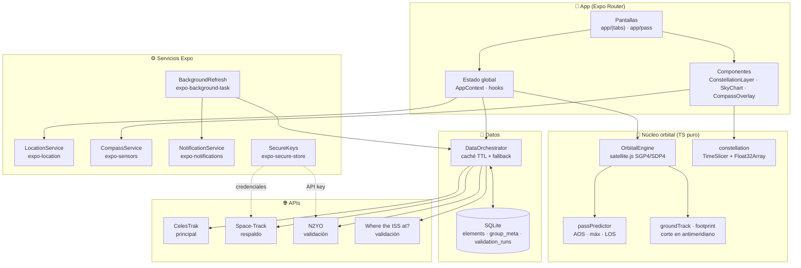
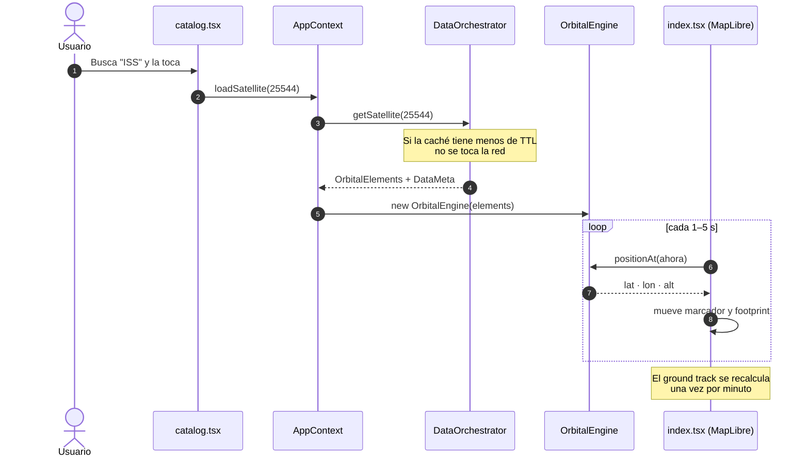
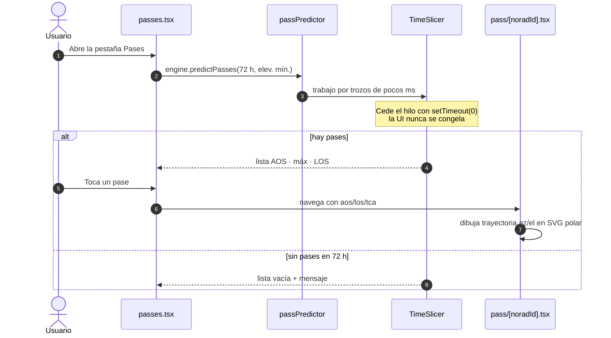
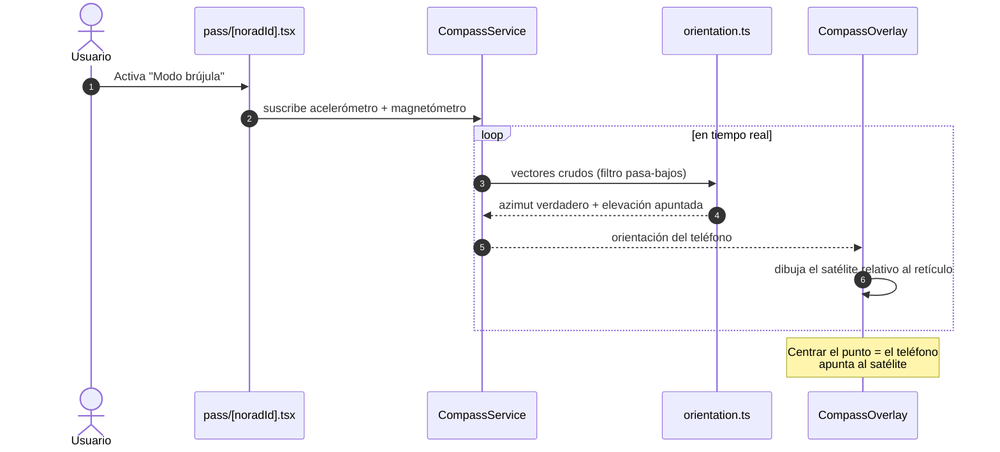
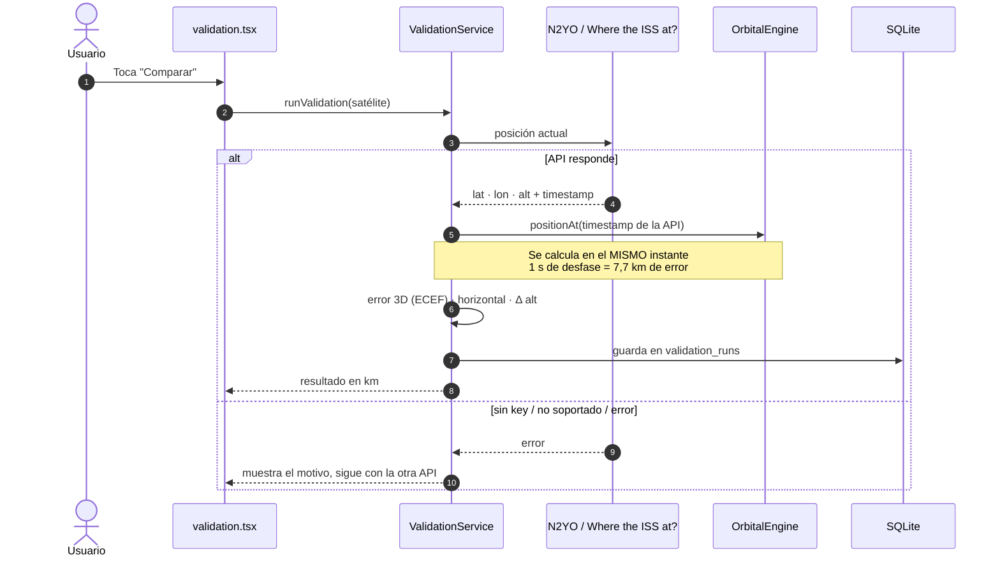
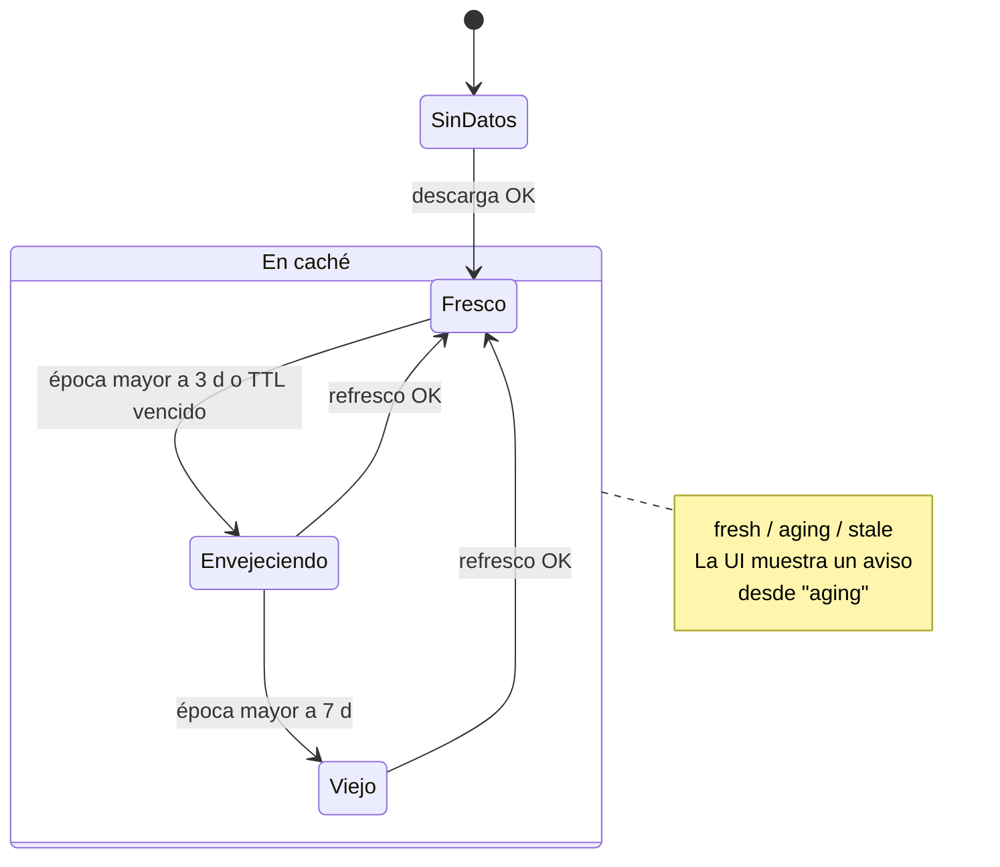
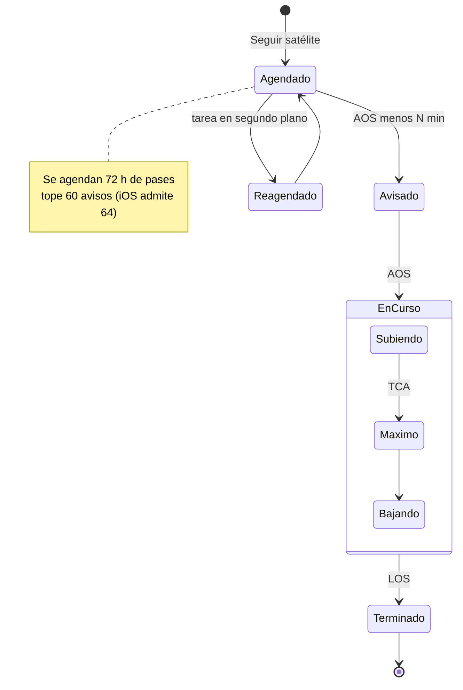
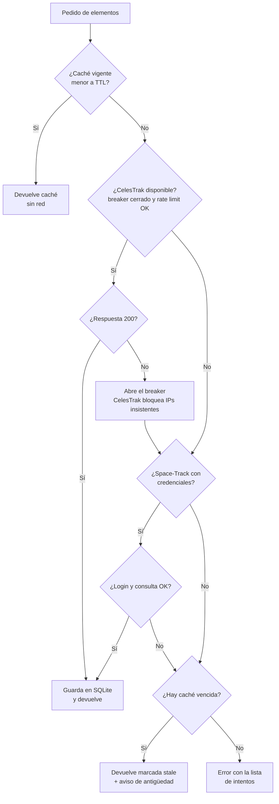
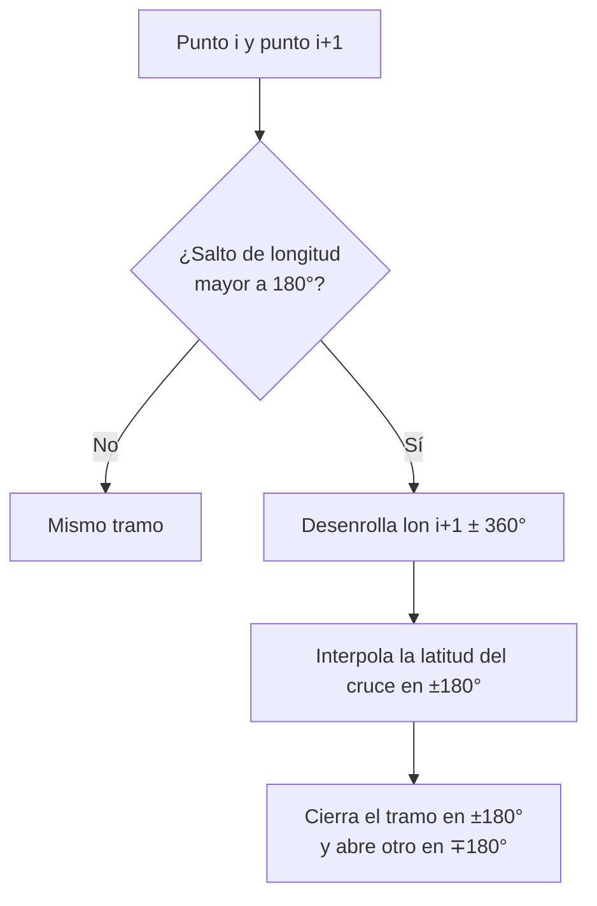

# 🛰️ Satellite Tracker — TP7 Desarrollo Mobile (FCyT · UADER)

App móvil que rastrea satélites en tiempo real **calculando todo en el teléfono con SGP4**: posición, azimut/elevación,
pases, ground track, footprint, avisos y brújula. Hecha con **React Native + Expo SDK 57 (Expo Router)**, `satellite.js`
y **MapLibre** (mapa open source, sin API key).

---

## 🏛️ Arquitectura



La regla de oro: **`src/core` no importa nada de React Native ni de Expo**. Así toda la matemática se prueba con Jest en Node.
La red solo se usa para bajar elementos orbitales; las posiciones se calculan siempre en el teléfono.

---

## 📱 Pantallas

| Pantalla | Qué hace |
|----------|----------|
| **01 · Mapa** (`app/(tabs)/index.tsx`) | Marcador del satélite en vivo (refresco 1–5 s), ground track pasado/futuro, footprint y capa de constelación. Tocar un punto de la constelación lo selecciona. |
| **02 · Catálogo** (`app/(tabs)/catalog.tsx`) | Busca por nombre o NORAD ID y filtra por grupo (Estaciones, Starlink, GPS, Clima, GEO). |
| **03 · Pases** (`app/(tabs)/passes.tsx`) | Próximos pases en 72 h. El cálculo es asíncrono y se cancela si cambiás de satélite. _Seguir este satélite_ agenda los avisos. |
| **04 · Vista de pase** (`app/pass/[noradId].tsx`) | Sky Chart polar con la trayectoria, AOS / máx / LOS, cuenta regresiva y modo brújula. |
| **05 · Validación** (`app/(tabs)/validation.tsx`) | Compara la posición local con N2YO / Where the ISS at? y muestra el error en km. Comparte la tabla en Markdown. |
| **06 · Ajustes** (`app/(tabs)/settings.tsx`) | TTL (12–24 h), elevación mínima, minutos de aviso, límite de constelación y credenciales. |

---

## 🔄 Diagramas de flujo (happy paths)

### 1. Ver un satélite en el mapa (RF-02, RF-10, RF-11 & RF-12)



### 2. Predecir un pase y ver el Sky Chart (RF-03, RF-04 & RF-05)



### 3. Apuntar con la brújula (RF-07)



### 4. Validación cruzada (RF-15)



---

## ♻️ Ciclos de vida

### Datos orbitales en caché (RF-09, RF-14 & RF-16)



El TTL dice cuándo **volver a descargar**; la época dice cuánto **confiar** en el dato. Por eso son dos relojes distintos.

### Pase y su notificación (RF-04 & RF-06)



Los avisos quedan programados en el sistema: suenan aunque la app esté cerrada. La tarea en segundo plano solo los reagenda.

---

## 🚨 Manejo de errores: orquestador de proveedores (RF-09 & RF-14)



Cada proveedor tiene su **rate limiter**, **circuit breaker** y **reintentos con backoff**. Si todo falla, la app sigue andando con datos viejos y lo avisa.

### Ground track en el antimeridiano (RF-11)



Sin este corte, el mapa dibujaría una línea horizontal falsa de punta a punta del mundo.

---

## 🛠️ Stack

- **Framework:** React Native 0.86 + Expo SDK 57 (Expo Router, typed routes, development build).
- **Cálculo orbital:** `satellite.js` 6 (SGP4/SDP4, TEME → geodésico, look angles).
- **Mapa:** `@maplibre/maplibre-react-native` v11 + tiles de OpenStreetMap vía OpenFreeMap (sin API key).
- **Gráficos:** `react-native-svg` (Sky Chart polar).
- **Datos y caché:** `expo-sqlite` (efemérides, validaciones y ajustes).
- **Sensores y SO:** `expo-location`, `expo-sensors`, `expo-notifications`, `expo-background-task`.
- **Secretos:** `expo-secure-store` (Keychain / Keystore).
- **Tests:** Jest + `jest-expo` (8 suites, 115 tests).

> ℹ️ Se usa MapLibre en lugar de `react-native-maps` porque en Android este último exige una clave de Google Maps
> con cuenta de facturación. Las polilíneas, polígonos y marcadores se dibujan como capas `line`, `fill` y `circle`.

---

## 🚀 Instalación

No hace falta Android Studio ni JDK: la app se compila en la nube de Expo (EAS) y el celular se conecta a la PC.

### 1. Instalar dependencias

```bash
npm install
npm install -g eas-cli
```

### 2. Iniciar sesión en Expo

```bash
eas login
```

### 3. Compilar la app de desarrollo (una sola vez)

```bash
npm run build:dev
```

Al terminar, EAS muestra un QR / link para bajar el APK al celular. Solo hay que repetirlo si cambian dependencias
nativas, plugins o `app.json`.

### 4. Levantar el servidor

```bash
npm start
```

Abrí la app en el celular (misma Wi-Fi que la PC) y conectate al servidor. Los cambios de código se ven al instante.

### Otros comandos

| Comando | Acción |
|---------|--------|
| `npm run typecheck` | TypeScript estricto |
| `npm test` | Jest (SGP4, pases, ground track, caché, fallback, rate limit, brújula) |
| `npm run build:apk` | APK autónomo para entregar (perfil `preview`) |
| `npm run doctor` | `expo-doctor` |

> ⚠️ No funciona en Expo Go: usa módulos nativos (MapLibre, sensores, background task).

---

## ⚙️ Configuración

No hay variables de entorno. Las cuentas son opcionales y se cargan dentro de la app, en **Ajustes**:

| Cuenta | Para qué | Dónde se saca |
|--------|----------|---------------|
| Space-Track (usuario + contraseña) | Respaldo si CelesTrak falla | https://www.space-track.org |
| N2YO (API key) | Validación RF-15 | https://www.n2yo.com/api/ |

CelesTrak y Where the ISS at? no piden cuenta. Sin ninguna credencial la app funciona igual.

---

## 🔒 Reglas

- **Credenciales** solo en `expo-secure-store`. Nunca en el código, en SQLite ni en el bundle.
- **TTL** siempre acotado a 12–24 h. El refresco forzado se ignora si pasaron menos de 2 h (política de CelesTrak).
- **Ubicación** solo _mientras se usa la app_. Los avisos usan la última ubicación guardada.
- **Hilo JS libre:** todo cálculo pesado va por `TimeSlicer` (Hermes no tiene Web Workers).
- **Starlink** se pide del set suplementario **SupGP** (efemérides del operador).

---

## ⚠️ Limitaciones

- La visibilidad es **geométrica**: no se calcula si el satélite está iluminado ni si es de noche.
- Footprint con **Tierra esférica**.
- Con Space-Track, los grupos se aproximan con filtros por nombre/período.
- La brújula depende de la calidad y calibración del magnetómetro.

---

## 📄 Documentos complementarios

- [`INFORME_TECNICO.md`](INFORME_TECNICO.md) — SupGP para Starlink, límites de APIs y caché, supuestos de SGP4 y
  resultados esperados de la validación.
- [`CLAUDE.md`](CLAUDE.md) — mapa del código archivo por archivo y guía de estilo de la documentación.
- Fuentes: [CelesTrak](https://celestrak.org) · [Space-Track](https://www.space-track.org) ·
  [N2YO](https://www.n2yo.com/api/) · [Where the ISS at?](https://wheretheiss.at/w/developer)
